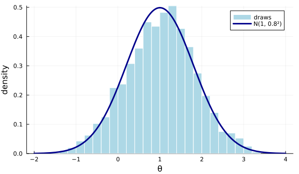
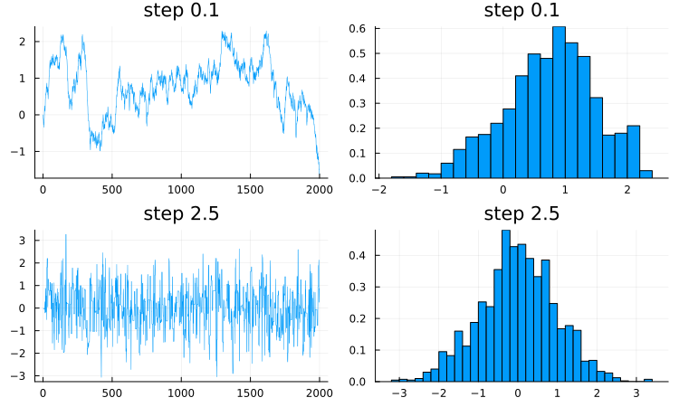
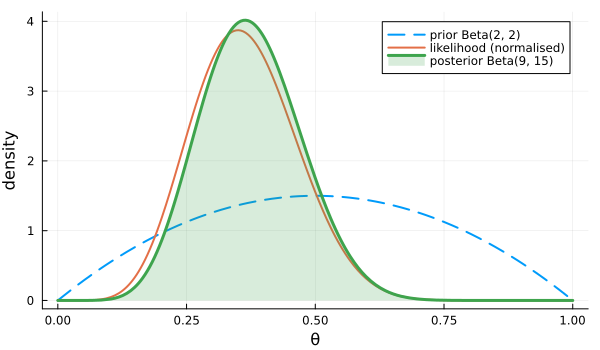
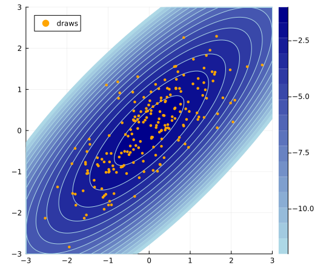
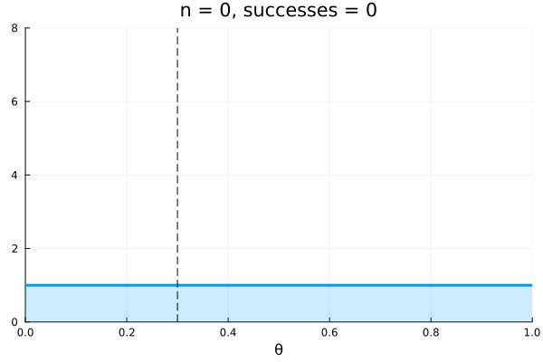
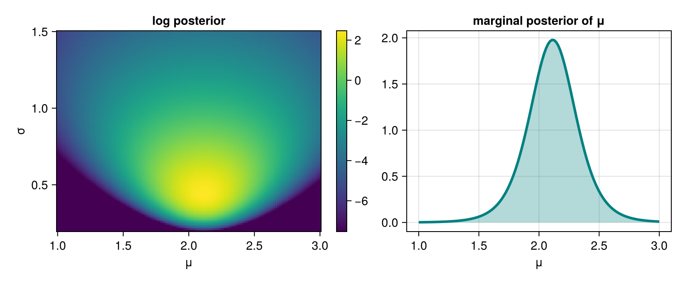

# Plotting

Plots.jl is the quickest way to get a figure; StatsPlots adds plots of distributions, data frames and MCMC chains. Makie is the newer, more flexible system for publication figures and interactive graphics.

<div class="cheatbox jl-cyan">

## Plots.jl basics

`plot` makes a new figure and `plot!` adds to the current one. Attributes are keyword arguments.

```julia
using Plots
x = range(0, 2π; length = 100)
plot(x, sin.(x); label = "sin", xlabel = "x", ylabel = "y", title = "Waves")
plot!(x, cos.(x); label = "cos", linestyle = :dash, linewidth = 2)
plot(sin, 0, 2π)                        # plot a function over an interval
scatter(randn(50), randn(50); markersize = 3, color = :red, alpha = 0.5)
histogram(randn(1000); bins = 30, normalize = :pdf)
hline!([0]; color = :black); vline!([1.0])
xlims!(0, 3); ylims!(-1, 1)
savefig("fig.png")                      # also .pdf and .svg
```

The first plot in a session takes a few seconds while Plots compiles. Later plots are fast.

<details class="example">
<summary>Example</summary>

A histogram of simulated draws with the true density on top.

```julia
using Plots, Random
rng = Xoshiro(1)
draws = randn(rng, 2000) .* 0.8 .+ 1
dens(x) = exp(-0.5 * ((x - 1) / 0.8)^2) / (0.8 * sqrt(2π))
histogram(draws; bins = 40, normalize = :pdf, label = "draws", color = :lightblue, linecolor = :white)
plot!(dens, -2, 4; label = "N(1, 0.8²)", linewidth = 3, color = :darkblue)
plot!(; xlabel = "θ", ylabel = "density", size = (600, 350))
savefig("histogram.png");
```



</details>
</div>

<div class="cheatbox jl-cyan">

## Several panels

Combine plots with `layout`. `size` is in pixels.

```julia
using Plots; x = range(0, 2π; length = 100)
p1 = plot(randn(100); title = "trace")
p2 = histogram(randn(100); title = "histogram")
plot(p1, p2; layout = (1, 2), size = (800, 300))
plot(p1, p2, p1; layout = @layout([a b; c]))   # two on top, one wide below
plot(rand(10, 4); layout = 4)                    # one panel per column
plot(x, [sin.(x) cos.(x)]; label = ["sin" "cos"])   # matrix columns are series; labels are a row
```

Several series in one call are the columns of a matrix, and their attributes are given as a row (`["a" "b"]`, not `["a", "b"]`).

<details class="example">
<summary>Example</summary>

Trace plots and histograms of two Metropolis chains with different step sizes.

```julia
using Plots, Random
function rwm(step, n; rng = Xoshiro(2))
    θ = 0.0; out = zeros(n)
    for i in 1:n
        θp = θ + step * randn(rng)
        log(rand(rng)) < -0.5 * (θp^2 - θ^2) && (θ = θp)
        out[i] = θ
    end
    out
end
plots = []
for step in (0.1, 2.5)
    d = rwm(step, 2000)
    push!(plots, plot(d; title = "step $step", label = "", linewidth = 0.5))
    push!(plots, histogram(d; bins = 30, normalize = :pdf, label = "", title = "step $step"))
end
plot(plots...; layout = (2, 2), size = (750, 450))
savefig("traces.png");
```



</details>
</div>

<div class="cheatbox jl-cyan">

## Statistical plots with StatsPlots

StatsPlots adds recipes for distributions, data frames and grouped data, and loads Plots for you.

```julia
using StatsPlots, Distributions
plot(Normal(0, 1); label = "N(0,1)")          # plot a distribution's pdf
plot!(TDist(3); label = "t(3)")
density(randn(1000))                          # kernel density estimate
boxplot(["a" "b"], [randn(50) randn(50) .+ 1])
violin(repeat(["x", "y"], 50), randn(100))
corrplot(randn(200, 3))                       # scatter matrix
using DataFrames; df = DataFrame(x = randn(20), y = randn(20), g = rand(["a", "b"], 20))
@df df scatter(:x, :y; group = :g)            # columns of a DataFrame
# plot(chain)                                 # MCMCChains: traces and densities
```

<details class="example">
<summary>Example</summary>

Prior, likelihood and posterior for a binomial proportion.

```julia
using StatsPlots, Distributions
a, b, s, n = 2, 2, 7, 20
plot(Beta(a, b); label = "prior Beta(2, 2)", linewidth = 2, linestyle = :dash)
plot!(Beta(s + 1, n - s + 1); label = "likelihood (normalised)", linewidth = 2)
plot!(Beta(a + s, b + n - s); label = "posterior Beta(9, 15)", linewidth = 3, fill = (0, 0.2))
plot!(; xlabel = "θ", ylabel = "density", size = (600, 350), legend = :topright)
savefig("beta.png");
```



</details>
</div>

<div class="cheatbox jl-cyan">

## Contours, heatmaps and surfaces

Pass the grid vectors and a function of `(x, y)`, or a matrix with one row per y value.

```julia
using Plots
x = range(-3, 3; length = 100); y = range(-2, 2; length = 80)
f(x, y) = exp(-(x^2 + 2y^2) / 2)
contour(x, y, f; levels = 10)
contourf(x, y, f; color = :viridis)
heatmap(x, y, f.(x', y))                 # matrix is length(y) × length(x)
surface(x, y, f; camera = (30, 40))
plot(x, y, f; st = :wireframe)
```

`f.(x', y)` gives a matrix with `y` along the rows, which is the orientation `heatmap` expects.

<details class="example">
<summary>Example</summary>

Contours of a correlated bivariate normal log density with draws on top.

```julia
using Plots, Distributions, Random
d = MvNormal([0.0, 0.0], [1.0 0.8; 0.8 1.0])
x = range(-3, 3; length = 120)
y = range(-3, 3; length = 120)
contourf(x, y, (a, b) -> logpdf(d, [a, b]); levels = 15, color = :blues, clims = (-12, -1))
z = rand(Xoshiro(3), d, 200)
scatter!(z[1, :], z[2, :]; color = :orange, markersize = 2.5, markerstrokewidth = 0, label = "draws")
plot!(; aspect_ratio = 1, size = (520, 450), xlims = (-3, 3), ylims = (-3, 3))
savefig("contour.png");
```



</details>
</div>

<div class="cheatbox jl-cyan">

## Animations

`@animate` collects one frame per loop iteration, and `gif` writes them out.

```julia
using Plots
anim = @animate for t in 1:50
    plot(x -> sin(x - t / 5), 0, 2π; ylims = (-1, 1), label = "")
end
gif(anim, "wave.gif"; fps = 15)
@gif for t in 1:50                         # shorter: animate and save in one go
    scatter([cos(t / 8)], [sin(t / 8)]; xlims = (-1, 1), ylims = (-1, 1))
end
```

<details class="example">
<summary>Example</summary>

The posterior of a success probability as the data come in one trial at a time.

```julia
using Plots, Distributions, Random
rng = Xoshiro(4)
y = rand(rng, 60) .< 0.3
anim = @animate for n in 0:60
    s = sum(y[1:n])
    plot(Beta(1 + s, 1 + n - s); xlims = (0, 1), ylims = (0, 8), linewidth = 3, label = "",
         fill = (0, 0.2), title = "n = $n, successes = $s", xlabel = "θ")
    vline!([0.3]; color = :black, linestyle = :dash, label = "")
end
gif(anim, "posterior.gif"; fps = 8, show_msg = false);
```



</details>
</div>

<div class="cheatbox jl-cyan">

## Makie

Makie builds a `Figure` of `Axis` objects and adds plots to them with mutating functions. CairoMakie makes static files and GLMakie opens interactive windows.

```julia
using CairoMakie                       # or GLMakie for interactive 3D and zooming
fig = Figure(size = (700, 300))
ax = Axis(fig[1, 1]; xlabel = "x", ylabel = "y", title = "lines")
lines!(ax, 0..2π, sin; label = "sin")  # 0..2π is an interval
scatter!(ax, rand(10) .* 6, rand(10); color = :red)
axislegend(ax)
ax2 = Axis(fig[1, 2]); hist!(ax2, randn(1000); bins = 30, normalization = :pdf)
save("fig.png", fig)                   # also .pdf and .svg
lines(1:10, rand(10))                  # quick version: returns figure, axis and plot
```

`fig[row, col]` places an axis in the grid layout. Colorbars and legends are placed the same way.

<details class="example">
<summary>Example</summary>

A two-panel figure: a heatmap of a log posterior with a colorbar, and its marginal for one parameter.

```julia
using CairoMakie
μs = range(1, 3; length = 120)
σs = range(0.2, 1.5; length = 120)
y = [2.1, 1.4, 2.9, 2.2, 1.7, 2.6, 1.9]
logpost(μ, σ) = -length(y) * log(σ) - sum((y .- μ) .^ 2) / (2σ^2) - log(σ)
L = [logpost(μ, σ) for μ in μs, σ in σs]

fig = Figure(size = (800, 330))
ax1 = Axis(fig[1, 1]; xlabel = "μ", ylabel = "σ", title = "log posterior")
hm = heatmap!(ax1, μs, σs, L; colorrange = (maximum(L) - 10, maximum(L)))
Colorbar(fig[1, 2], hm)
post = exp.(L .- maximum(L))
ax2 = Axis(fig[1, 3]; xlabel = "μ", title = "marginal posterior of μ")
band!(ax2, μs, zeros(length(μs)), vec(sum(post; dims = 2)) ./ sum(post) ./ step(μs); color = (:teal, 0.3))
lines!(ax2, μs, vec(sum(post; dims = 2)) ./ sum(post) ./ step(μs); color = :teal, linewidth = 3)
save("makie.png", fig)
```



</details>
</div>
